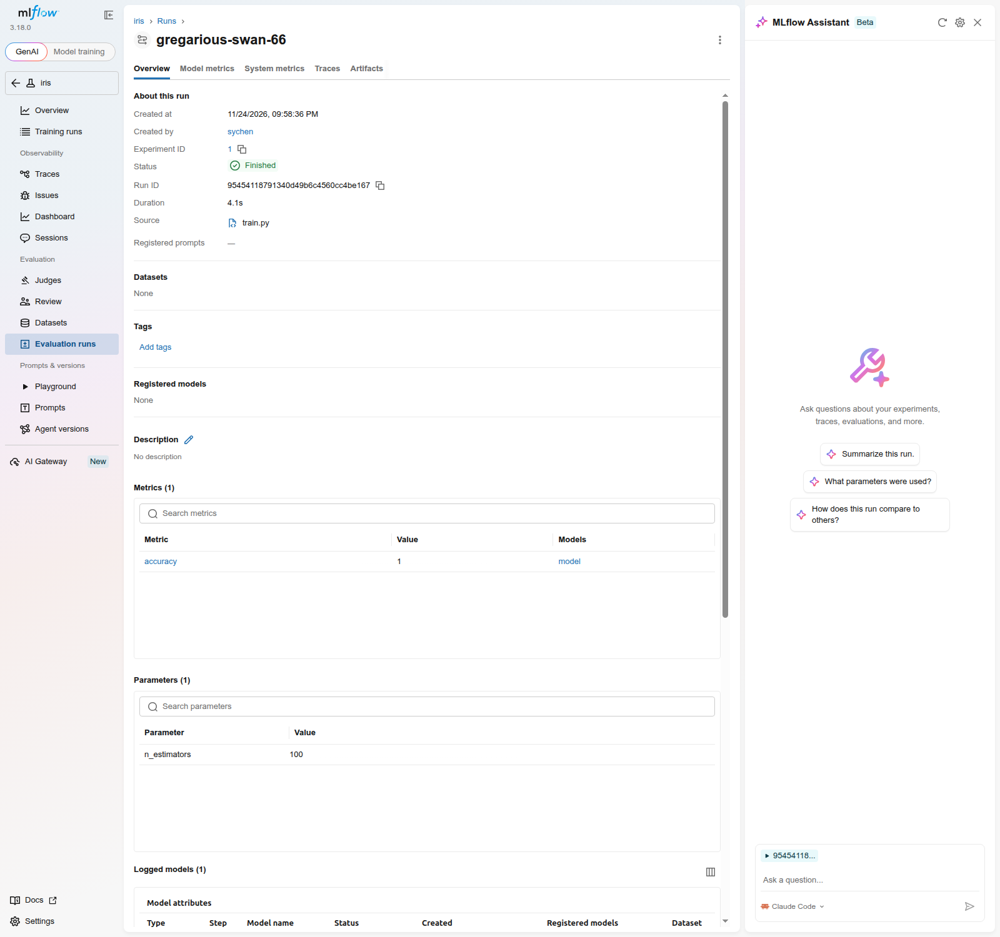
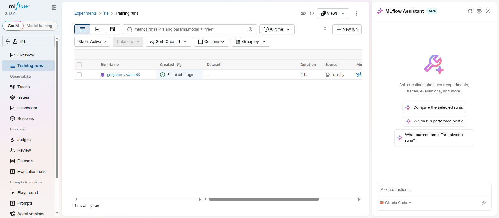
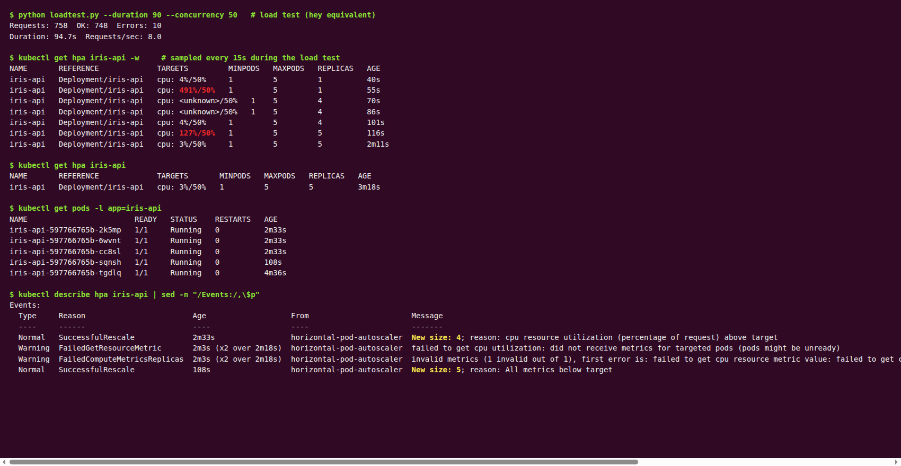

# MLOps Lab 1: Your First Model Service on Kubernetes

Train an Iris classifier with **scikit-learn**, track it with **MLflow**, serve it with **FastAPI**,
package it with **Docker**, deploy it to a **kind** Kubernetes cluster, and autoscale it with an **HPA**.

```
train.py ──(MLflow: params · metrics · model)──> model.pkl
app.py (FastAPI /predict, /healthz) + model.pkl ──docker build──> iris-api:v1
kind load docker-image ──> Deployment iris-api (cpu req 100m, readinessProbe /healthz)
                          Service iris-api (ClusterIP :80 → 8080)
                          HPA (cpu 50%, 1 → 5 replicas) + metrics-server
kubectl port-forward ──> curl / hey load test
```

## Repository layout

| Path | Description |
|---|---|
| `train.py` | Trains a RandomForest on Iris, logs params/metrics/model to MLflow, saves `model.pkl` |
| `app.py` | FastAPI service: `POST /predict`, `GET /healthz` |
| `requirements.txt` | Pinned serving dependencies (same scikit-learn version as training) |
| `Dockerfile` | Container image `iris-api:v1` |
| `k8s/deployment.yaml` | Deployment + Service |
| `k8s/hpa.yaml` | HorizontalPodAutoscaler (cpu 50%, min 1, max 5) |
| `k8s/metrics-server-patch.sh` | Installs metrics-server for kind |
| `loadtest.py` | Python load generator (equivalent of `hey -z 60s -c 50`) |
| `screenshots/` | MLflow run and HPA scaling results |

## How to run

### 1. Train and track with MLflow
```bash
python3 -m venv .venv && source .venv/bin/activate
pip install mlflow scikit-learn==1.9.1 joblib fastapi uvicorn
python train.py
mlflow ui --backend-store-uri sqlite:///mlflow.db   # http://localhost:5000
```

### 2. Build image and deploy to kind
```bash
kind create cluster --name mlops
docker build -t iris-api:v1 .
kind load docker-image iris-api:v1 --name mlops
kubectl apply -f k8s/deployment.yaml
kubectl get pods -w
kubectl port-forward svc/iris-api 8080:80 &
curl -X POST localhost:8080/predict \
  -H "Content-Type: application/json" \
  -d '{"instances": [[5.1, 3.5, 1.4, 0.2]]}'
# {"predictions":[0]}
```

### 3. Autoscale with HPA
```bash
./k8s/metrics-server-patch.sh
kubectl apply -f k8s/hpa.yaml      # or: kubectl autoscale deployment iris-api --cpu-percent=50 --min=1 --max=5
kubectl get hpa iris-api -w        # in another terminal
python loadtest.py --duration 90 --concurrency 50
# or, with hey installed:
# hey -z 60s -c 50 -m POST -T application/json \
#   -d '{"instances": [[5.1, 3.5, 1.4, 0.2]]}' http://localhost:8080/predict
```

> Note: `kubectl port-forward` sends all traffic to a single pod, so new replicas may receive little load,
> but the HPA still scales out based on the average CPU of the deployment.

## Results

### MLflow run
Experiment `iris`: run finished with `n_estimators=100`, `accuracy=1.0`, and the model logged as an artifact.





### HPA scaling
Under load, CPU went to 491% of the request (target 50%). The HPA scaled the deployment **1 → 4 → 5** replicas (max).
Raw output: [`screenshots/hpa_scaling.txt`](screenshots/hpa_scaling.txt)


